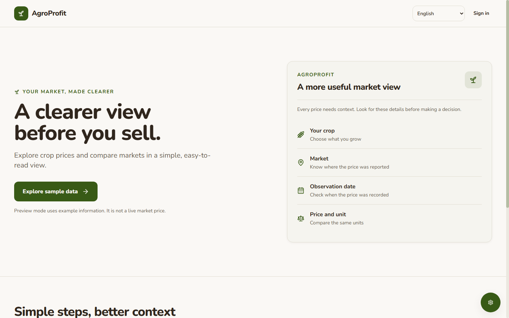
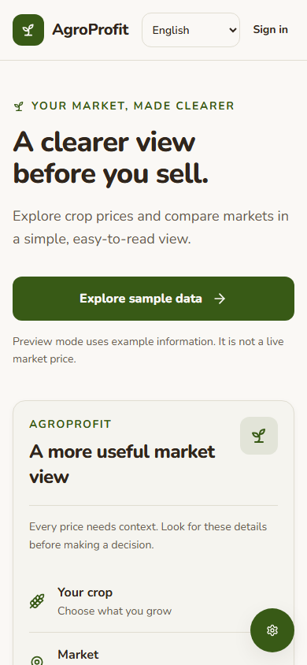
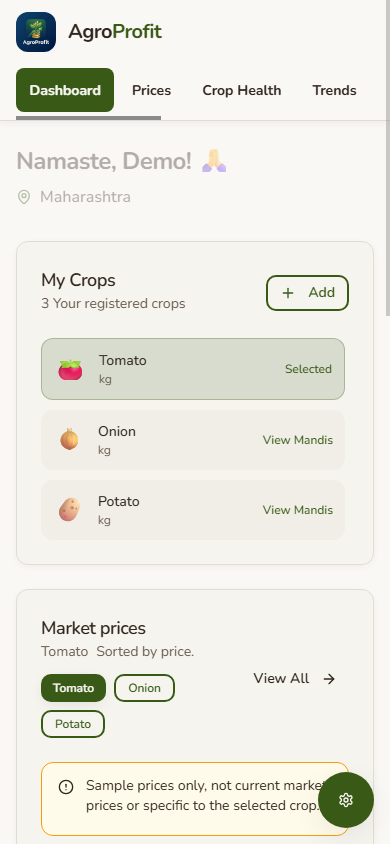
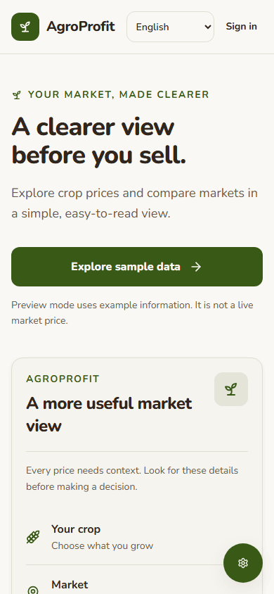
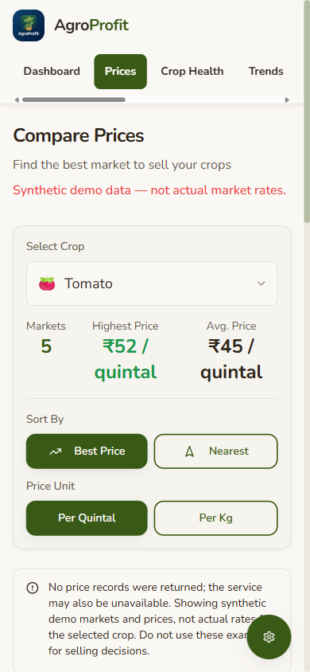
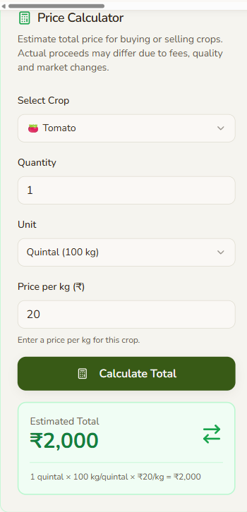
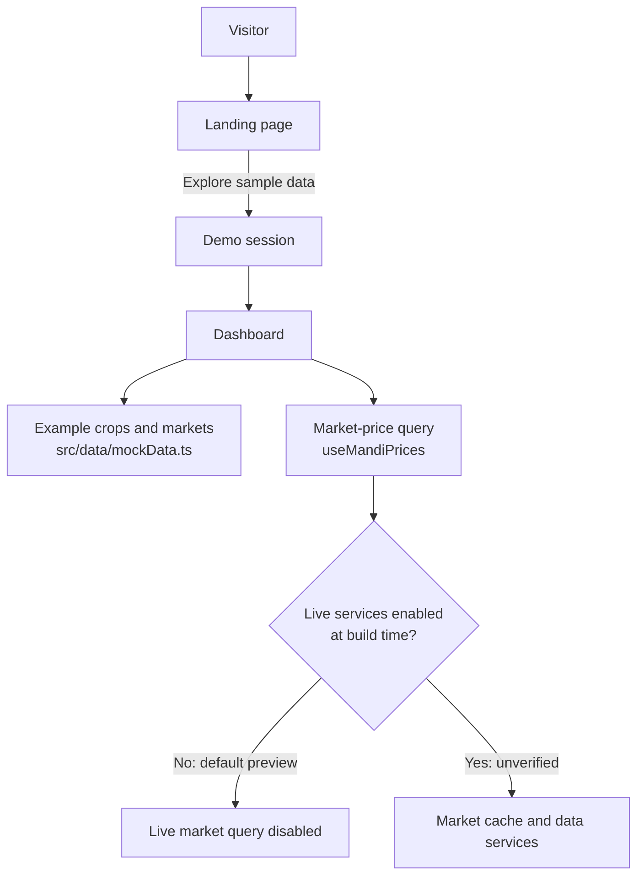
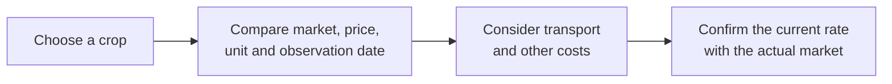

# AgroProfit: farmer-first market information

AgroProfit is a React and TypeScript application for exploring crop and mandi
information. This directory is an **isolated redesign in progress**; it was
exported from the original `AGRO-PROFIT` checkout without changing that
checkout or copying `.env.example`.

## Important: preview data is not a market quote

The redesign is being prepared to work without old credentials. Any example
prices must be labeled **sample data**, not “live”. A price observation should
include its commodity, market, unit, source and observation date when available.
Confirm the current price with the actual market before travelling or selling.
Straight-line distance is not a driving route; estimates are not guaranteed
earnings or agricultural advice.

Live Supabase, government data feeds, weather and AI integrations have **not**
been verified in this workspace. Do not provide or paste old API keys. Never put
secret/service-role keys in browser code or `VITE_` environment variables. Do
not deploy this preview or apply database migrations to a real project without a
separate security and data-policy review.

## Preview

These are screenshots of the local redesign preview, not a live service. The
landing page offers **Explore sample data**, which starts a demo session and
opens the dashboard. The mobile dashboard shows example crops and a sample-price
warning; its prices are not current or necessarily specific to the chosen crop.

### Landing page — desktop



### Landing page — mobile



### Demo dashboard — mobile



### Sample-data flow — mobile

The animation is assembled from the three actual screenshots above plus the price comparison screen.
Every price shown is synthetic and labeled as such; the flow is a UI preview, not a market feed.



### Price comparison — mobile



### Calculator — mobile

The unit conversion is part of the tested logic: one quintal is 100 kg, so ₹20/kg is ₹2,000 per
quintal. The result is labeled an estimate; fees, quality and market changes are not included.



## How the preview is organized

The diagram describes the preview path in the source, not a verified production
deployment. `App.tsx` selects the web or native router and provides the shared
auth, theme and query contexts. The dashboard uses example data and can request
market data through a gated hook.



Live integrations are disabled by default unless
`VITE_ENABLE_LIVE_SERVICES` is explicitly set to `true` at build time. The
inherited server routes are disabled in the preview. Enabling the flag does not
verify Supabase, government feeds, weather, AI, or any other integration, nor
does it make this preview safe to deploy.

For any price decision, follow the context shown on the landing page rather
than treating the examples as a quote:



## What is verified

| Check | Latest recorded result | What it does not prove |
| --- | --- | --- |
| `npm test` | 77 passed | Many checks inspect source; they are not full browser tests |
| `npm run typecheck` | passed | Types do not prove runtime behavior |
| `npm run build` | passed with `VITE_*` cleared | A build does not validate live integrations |
| Local mobile preview | 390px, nine routes, no observed overflow, console errors or external requests | Not a physical device or screen-reader audit |
| `npm run lint` | **fails:** 87 errors, 13 warnings | Remaining issues are not all classified as inherited or introduced |
| Live services | disabled by default | Supabase, agmarknet, weather, AI and RLS remain unverified |

See [`VERIFICATION.md`](VERIFICATION.md) for commands, dates and limitations.

## Working locally

Requirements observed for this development session: Node.js 24 and npm. From
this directory, an authorized local install was run with lifecycle scripts
disabled:

```sh
npm ci --ignore-scripts --no-audit --no-fund
```

Run `npm test`, `npm run typecheck`, and `npm run build` for local checks.
Run `npm run preview -- --host 127.0.0.1` to preview a production build.
Repository-wide lint currently fails; see [`VERIFICATION.md`](VERIFICATION.md)
for the observed results and limitations. The install may need internet access.
Do not assume an API or database is available elsewhere.

## Read next

- [`DESIGN.md`](DESIGN.md): audience, visual direction and safety constraints.
- [`IMPLEMENTATION_PLAN.md`](IMPLEMENTATION_PLAN.md): scoped implementation and
  verification work.
- [`RESEARCH.md`](RESEARCH.md): source snapshot, product sources and known risks.
- [`docs/LEGACY_README.md`](docs/LEGACY_README.md): preserved historical README;
  its claims are not evidence for this redesign.

The existing routes for markets, calculator, profile, crop health, forum, chat,
resources and exports are under review. A route existing in source does not
establish that it works end to end without the necessary services.
